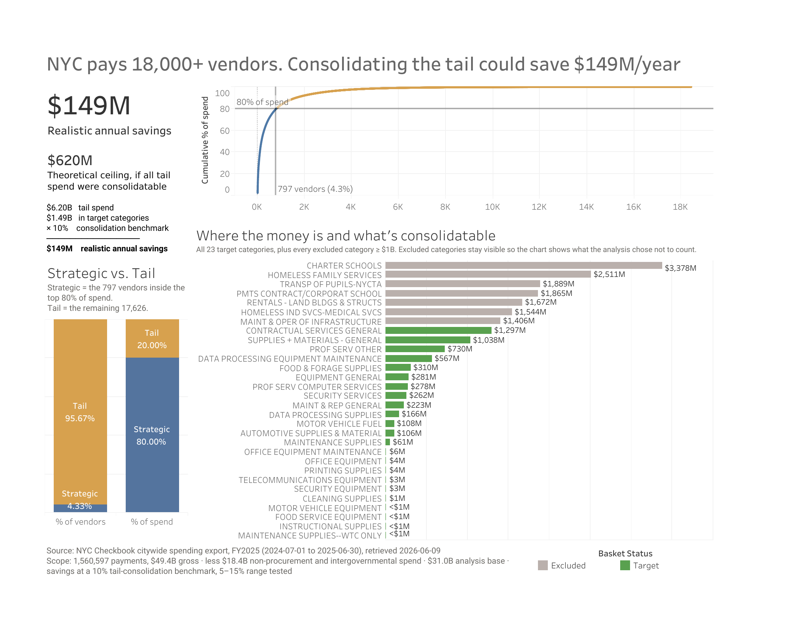

# NYC Vendor Rationalization: Tail-Spend Consolidation Analysis

New York City could realistically save about **$149M a year** by consolidating its small suppliers in the categories where consolidation actually works. Depending on the savings rate, the range is $75M-$224M. If every dollar of tail spend could be consolidated, the ceiling would be about $620M, but most of it can't, so I report both numbers and use the smaller one as the headline.

797 vendors (4.3%) account for 80% of the city's $31.0B in addressable spend, and the other 17,626 vendors share the remaining $6.2B. That long tail includes rents, legal settlements and human-services contracts that no volume deal can touch. So the headline only counts tail spend in 23 categories that can realistically be consolidated, which comes to $1.49B.

**[Interactive dashboard on Tableau Public](https://public.tableau.com/views/NYCVendorRationalization/Dashboard1)**

## The question

A few large vendors get most of a city's procurement dollars, and thousands of small ones split the rest. Every extra vendor means another contract to manage, more invoices to process, and no volume discount. In procurement this is called vendor rationalization, or tail-spend management.

> If NYC consolidated its long tail of small suppliers, how much could it save per year?

## Data and scope

**Source:** NYC Checkbook (checkbooknyc.com) citywide spending export for FY2025 (July 1, 2024 to June 30, 2025), downloaded on 2026-06-09. It came as four CSV files, about 415 MB in total.

**Tools:** MySQL with DBeaver for the analysis, Tableau for the dashboard.

Gross spend is $49.40B and the analysis uses $31.00B. Every removal is listed in the cleaning decisions log below.

| Stage | Rows | Spend | Removed |
|---|---|---|---|
| Raw extract | 1,560,597 | $49.40B | - |
| After scoping (pensions, negatives, placeholder values) | 1,554,107 | $39.43B | 6,490 rows / $9.97B |
| After removing payments to other governments | 1,552,117 | $31.00B | 1,990 rows / $8.43B |
| **Analysis table** (`payments_normalized`) | **1,552,117** | **$31.00B** | 18,423 distinct vendors |

Most of the gap comes from two things that aren't procurement: $5.0B of placeholder values from the pension system, and $8.43B paid to other governments and public authorities. The city's Medicaid payments to New York State, for example, can't be put out to bid.

## Reproducing this analysis

1. Download the FY2025 citywide spending export from [checkbooknyc.com](https://www.checkbooknyc.com). The export tool splits large results into several CSV files; put them in `Data/Raw/`. The raw data isn't committed because it's over GitHub's file size limit.
2. The four `LOAD DATA LOCAL INFILE` statements in `00_load.sql` use paths relative to the repo root (`Data/Raw/…`), so run the script from the repo root or change them to absolute paths.
3. Run the scripts in order against a local MySQL 8 instance. `LOAD DATA LOCAL INFILE` needs `local_infile` turned on in the server, and you have to reconnect the client afterwards.
4. Each script ends with a reconciliation query. If a row count doesn't match the number in the comment, re-run the load before going further. A malformed row that gets skipped silently would throw off every number after it.

| File | What it does |
|---|---|
| `00_load.sql` | Creates the database and `payments_raw` and loads the four CSV files. The MySQL totals match a direct sum of the source files to the penny |
| `01_profile.sql` | Profiling: row counts, date range, nulls, spend distribution, agency and payee concentration, duplicate names |
| `02_normalize.sql` | Removes non-procurement rows (`payments_scoped`), cleans payee names, removes government payees (`payments_normalized`) |
| `03_analysis.sql` | Pareto split, tail-spend savings, category fragmentation, top vendors |

The query results are exported to `Exports/` as CSVs, and those are what the Tableau workbook reads.

## What I found

**Profiling**
- The data covers exactly one fiscal year, so the savings figure is already annual.
- There are no null payment amounts.
- There are 18,502 distinct payee names.
- Amounts range from -$13.3M (refunds and reversals) up to exactly $99,999,999.00. That top value is a system cap used as a placeholder: 50 rows, all pension funding, $5.0B in total. I also found repeated round amounts, like ten identical $43,000,000 checks, which are large obligations paid in installments. That's why I added up spend per vendor instead of looking at individual checks.

**Scoping**
- Removing pension contributions, negative amounts and the placeholders took out 6,490 rows (0.4% of rows) but $9.97B (20% of the dollars).
- The biggest surprise was that the top remaining "vendors" weren't vendors at all: State of New York ($6.2B, mostly Medicaid), NYC Housing Authority, NY Power Authority and MTA Bus. These are payments between governments, not purchases.
- My rule was to exclude payees that are themselves governments or public authorities, and keep nonprofits and companies that hold competed contracts. I kept borderline cases like charter schools and library subsidies. They all ended up among the largest vendors anyway, so they don't affect the tail-spend number.

**Cleaning vendor names**
- The steps: uppercase, remove punctuation, collapse extra spaces, drop a leading "THE", and drop one trailing legal suffix (INC, LLC, CORP and so on).
- That merged 74 duplicate names (from 18,502 to 18,428 vendors), and some of them carried real money. School Specialty ($26.9M), Wilson Language ($14.7M) and Imagine Learning ($11.9M) were each split across two spellings.
- My first suffix list also removed words like FOUNDATION, GROUP, SERVICES and ASSOC. That wrongly merged separate organizations, for example a Chamber of Commerce with its charitable foundation. Taking those words out of the list dropped the merges from 77 to 74, and I could check each remaining one by hand.
- I didn't use fuzzy matching. In spend data, a wrong merge makes one vendor look bigger and another look smaller, and nothing later in the analysis would catch it. NYC's vendor names were clean enough that simple rules were enough.

## Cleaning decisions log

| Exclusion | Why | Impact |
|---|---|---|
| Pension Contributions agency | A transfer between governments, not procurement | part of the $9.97B below |
| `check_amount <= 0` | Refunds and reversals, not money going out; $0 rows distort counts | -$82M in negatives |
| `check_amount = 99,999,999` | System-cap placeholder values, all pension funding | 50 rows, $5.0B |
| **Subtotal (stage 1)** | | **6,490 rows / $9.97B removed; $39.43B left** |
| Government and authority payees (State of NY, NYCHA, NYPA, MTA Bus, Office of Labor Relations) | Payments to other governments that got past the agency filter; procurement can't act on them | 1,990 rows / **$8.43B** (21% of the remaining dollars in 0.13% of rows) |
| **Final analysis table (`payments_normalized`)** | | **1,552,117 rows / 18,423 vendors / $31.00B** |

## Results

**Pareto split and savings**
- 797 of 18,423 vendors (4.33%) cover 80% of spend ($24.80B). The other 17,626 (95.67%) share $6.20B.
- **Ceiling:** if all tail spend could be consolidated, that's $6,199,890,536, or savings of $310.0M / $620.0M / $930.0M at a 5% / 10% / 15% savings rate.
- **Realistic:** counting only tail spend in 23 goods and general-services categories gives $1,491,973,800, or **$74.6M / $149.2M / $223.8M**. I picked the categories by checking every expense category against one rule and including every match, even the tiny ones, so the list wasn't chosen to hit a number. I left out borderline categories and noted why in the SQL: legal services (court-driven and specialized), telecom (few suppliers, works like a utility), curriculum and professional development (could go either way), and "Othr Serv and Chrgs - General" ($516M of spending with no useful label).
- The realistic figure is about a quarter of the ceiling because most tail dollars (rent, settlements, one-off payments, human-services contracts) can't be consolidated.
- The borderline payees I kept during scoping (charter schools, libraries, the UFT Welfare Fund) all landed among the largest vendors, as expected, so none of them affect the tail.

**Where to consolidate**

These categories have many vendors, no dominant supplier, and goods or services the city chooses to buy:

1. **Contractual Services - General:** $1.30B across 1,985 vendors; the largest supplier has only 6.0%
2. **Supplies + Materials - General:** $1.04B across 3,853 vendors; the largest supplier has 11.8%
3. **Prof Serv - Other:** $730M across 1,326 vendors, although the largest supplier already has 26.7%
4. **Equipment - General:** the same pattern on a smaller scale

Some fragmented categories don't make sense to consolidate: Charter Schools ($3.4B of required per-pupil payments), Payments to Delegate Agencies, and homeless-services categories, which are networks of social-service providers rather than purchases you can bundle. Maintenance & Operation of Infrastructure is already 57% with one supplier.

**Examples of fragmented buying**
- CDW Government received 48,208 separate payments from 48 different agencies, $399M in total, and SHI International was paid by 60 agencies. Dozens of agencies are buying IT from the same suppliers separately.
- Cleaning the names turned School Specialty from two mid-size vendors into one $26.9M relationship. The 74 merges together covered more than $100M.
- `spending_category` had only one value ("Contracts") after scoping, so I used `expense_category` for the category analysis.

## Dashboard

I built the dashboard in Tableau from the CSVs in `Exports/`. From top to bottom: the two savings figures ($149M realistic, $620M ceiling), the Pareto curve with the 797-vendor cutoff marked, bars comparing the share of vendors and spend in each tier, and a category chart colored by whether each category was included.

The category chart shows all 23 included categories plus every excluded category over $1B, so you can see what I left out. Charter Schools is at the top, in grey. The four smallest included categories show as $0M at the chart's rounding. The chart scrolls so the important bars stay at the top. A one-page PDF of the dashboard is in `Data Viz/`.

## Limitations

1. **One fiscal year only,** so there's no trend view. A vendor in the tail this year might be growing.
2. **The savings rate is an assumption.** 5% / 10% / 15% is a common industry range applied to the addressable spend. The data gives the spend ($1.49B realistic, $6.20B ceiling) and the rate is an assumption, so the result scales directly with whatever rate you pick.
3. **"Othr Serv and Chrgs - General" ($516M) has no useful label.** Some of it could probably be consolidated, but I can't tell which part, so I left it out.
4. **Some rows have an N/A expense category.** The dollars are small. They're included in the totals but can't be assigned to a category.
5. **No fuzzy matching,** so abbreviations and typos ("NY" vs "New York") aren't merged.
6. **The 80% cutoff is a convention.** Moving it would shift the split a little but wouldn't change the conclusion.
